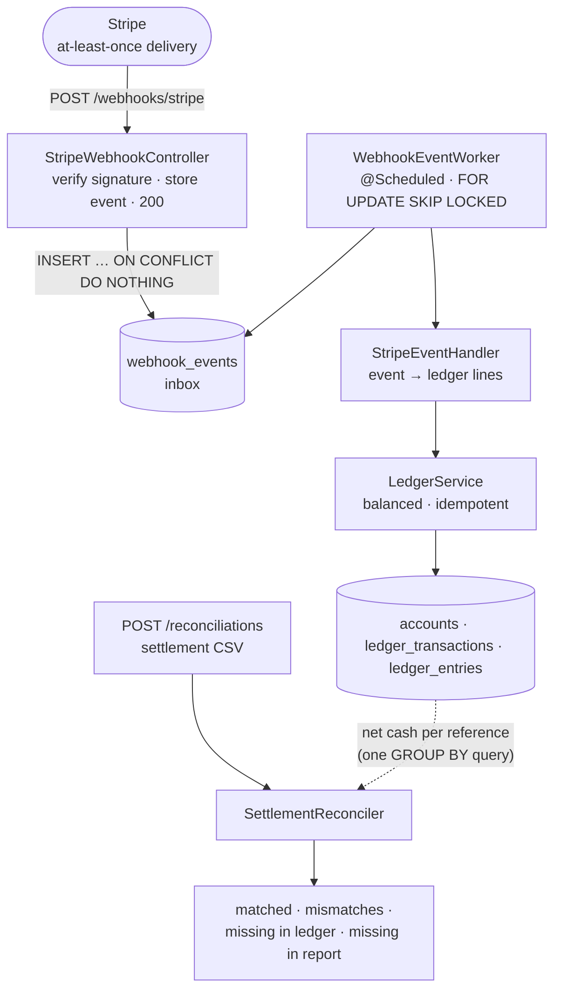

# payments-ledger

**Idempotent Stripe webhooks · double-entry ledger · settlement reconciliation**
Java 21 · Spring Boot 4 · PostgreSQL 17 · Flyway · Testcontainers

[](https://github.com/Parakhatdin/payments-ledger/actions/workflows/ci.yml)

A small, focused payments backend that does the three things a payments system has to get **correct**, not just working:

1. **Ingest Stripe webhooks safely.** Verify the signature, answer in milliseconds, and book every payment **exactly once**, although Stripe delivers *at least once* and retries.
2. **Book money on a double-entry ledger.** Every posting balances (debits = credits) or it is rejected. No floating-point numbers anywhere.
3. **Reconcile against the processor's settlement report.** Find the payments where Stripe and the ledger disagree before they turn into a support ticket or an audit finding.

It is deliberately small, so the correctness decisions are easy to read. **38 tests**, including a concurrency test against a real PostgreSQL.

---

## Why these three things

Payments break in quiet, expensive ways:

| Failure | What protects against it here |
|---|---|
| A webhook is delivered twice, and the sale is booked twice | `UNIQUE` constraints on the event id **and** on the ledger idempotency key |
| Two workers process the same retry at the same moment | The database constraint, not a "check, then insert" in Java (that has a race window) |
| Someone posts a fake "payment succeeded" to the public webhook URL | HMAC-SHA256 signature check, constant-time compare, replay window |
| `0.1 + 0.2 != 0.3`, and the books drift by a cent | `long` minor units in an immutable `Money` record |
| Stripe settles a payment that we never recorded (or the reverse) | Reconciliation report with four buckets |

---

## Architecture



### Exactly-once booking = at-least-once processing + idempotent effect

```
Stripe ──(may retry)──▶ POST /webhooks/stripe
           │
           ├─ 1. Verify Stripe-Signature ............. invalid ▶ 400, nothing stored
           ├─ 2. webhook_events.event_id UNIQUE ....... same event again ▶ 200, stored once
           │      (the HTTP request ends here: fast 200, no business logic)
           │
   worker ─┴─ 3. ledger_transactions.idempotency_key UNIQUE ("stripe:pi:<PaymentIntent id>")
                  └─ a different event about the same payment, or a retry after a crash ▶ no second posting
```

The idempotency key is per **PaymentIntent**, not per event: Stripe can send several events about one payment, and the money must still be booked once.

### How a payment is booked

Stripe pays out **net** of its fee, so the cash account holds the net amount. That is what makes reconciliation line up with Stripe's settlement report:

| | Account | Amount (for a €100.00 payment, €3.20 fee) |
|---|---|---|
| DEBIT | `assets:stripe_cash` | 9,680 |
| DEBIT | `expenses:stripe_fees` | 320 |
| CREDIT | `revenue:sales` | 10,000 |

`checkout.session.completed` is ignored on purpose: a paid Checkout Session also produces a `payment_intent.succeeded`, and booking both would count the sale twice. There is a test for exactly this.

---

## Design decisions

- **The database is the source of truth for idempotency.** `LedgerService` looks the key up first (fast path for normal retries), then inserts. If a concurrent request wins the race, PostgreSQL rejects our insert with a unique violation and we return the winner's row. `LedgerServiceTest` fires 8 threads at the same key: 1 writes, 7 recover.
- **The insert runs in its own transaction** (`REQUIRES_NEW` in `LedgerWriter`). A unique violation then rolls back only that insert, and the worker's surrounding transaction is not poisoned. It is a separate bean because `@Transactional` works through a Spring proxy: a call inside the same class would ignore it.
- **Inbox + worker instead of processing inside the request.** Stripe wants a 2xx within seconds and retries otherwise. The request only stores the event; the worker books it. `FOR UPDATE SKIP LOCKED` lets several instances poll the same table without double-processing or waiting on each other.
- **Failures are retried, then parked.** A failing event keeps its error message and is retried on later polls; after `max-attempts` it becomes `FAILED` for a human to look at, and the rest of the batch carries on.
- **Flyway owns the schema**, Hibernate only validates it (`ddl-auto: validate`). Constraints such as `amount > 0` and the `UNIQUE` keys live in SQL, where every writer has to respect them.
- **`open-in-view: false`.** No lazy loading from controllers; services return records (`PostedTransaction`), not JPA entities.
- **Errors are RFC 9457 problem details** (`ApiExceptionHandler`). A bad signature gets a generic message; the reason is only logged.

---

## Running it

Requirements: Java 21 and Docker. No local PostgreSQL needed: Spring Boot starts the one in `compose.yaml` automatically.

```bash
./mvnw spring-boot:run                 # starts PostgreSQL + the app on :8080

scripts/send-test-webhook.sh pi_demo_1 10000 320   # a correctly signed payment_intent.succeeded
scripts/send-test-webhook.sh pi_demo_2 5000 175
scripts/send-test-webhook.sh pi_demo_3 2000 88

curl -X POST localhost:8080/reconciliations \
     -H 'Content-Type: text/csv' --data-binary @scripts/sample-settlement.csv
```

The sample report is built to show every bucket: `pi_demo_1` matches, `pi_demo_2` has a different fee, `pi_demo_3` was never settled, and `pi_not_in_ledger` was settled but never booked.

Point a real Stripe webhook at `POST /webhooks/stripe` and set `STRIPE_WEBHOOK_SECRET` to the endpoint's signing secret.

```bash
docker build -t payments-ledger .      # multi-stage image, runs as non-root
```

## Tests

```bash
./mvnw verify                          # unit + integration tests (Testcontainers starts PostgreSQL)
```

| Test | What it proves |
|---|---|
| `MoneyTest` | exact arithmetic, currency safety, exact decimal parsing (EUR 2 digits, JPY 0), overflow detection |
| `BalanceRulesTest` | unbalanced, single-line, zero-amount and mixed-currency postings are rejected |
| `StripeSignatureVerifierTest` | valid / tampered / wrong secret / replayed / malformed signatures; secret rotation |
| `LedgerServiceTest` | three-leg posting, idempotent retries, **8-thread race books once**, full rollback on errors |
| `StripeWebhookFlowTest` | HTTP → inbox → worker → ledger end to end; duplicates; forged requests; retry-then-park; no double count with Checkout |
| `ReconciliationTest` | all four buckets via the REST endpoint; clean report; bad CSV → 400 |
| `SettlementCsvParserTest` | column order, extra columns, line numbers in errors |

CI runs the full suite on every push (GitHub Actions).

---

## What I would add next

- Refunds and disputes (`charge.refunded`, `charge.dispute.created`) as reversing postings
- Exponential backoff between retries (`next_attempt_at`) instead of retrying on every poll
- Fetching the fee from the Stripe API when the event payload does not include the balance transaction
- Metrics for inbox lag and parked events (Micrometer → Prometheus) and an alert on `FAILED`
- An outbox to publish `PaymentBooked` events to Kafka for other services
